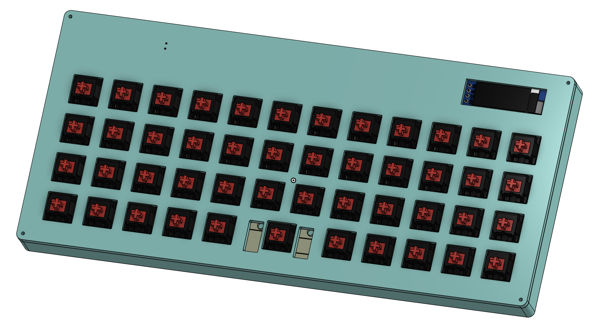
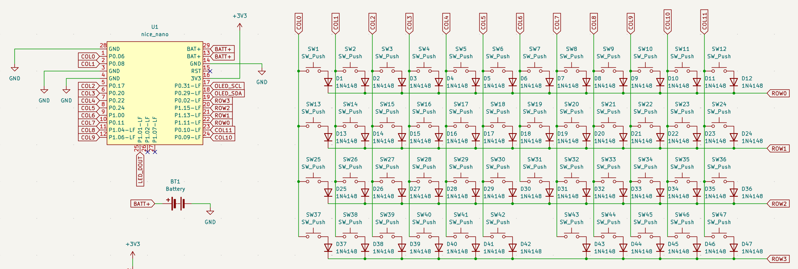
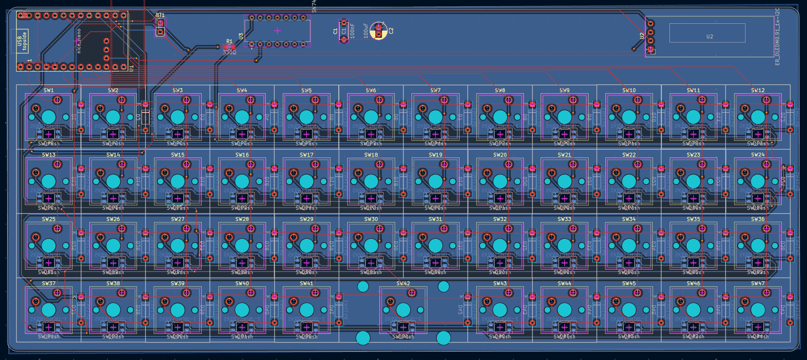
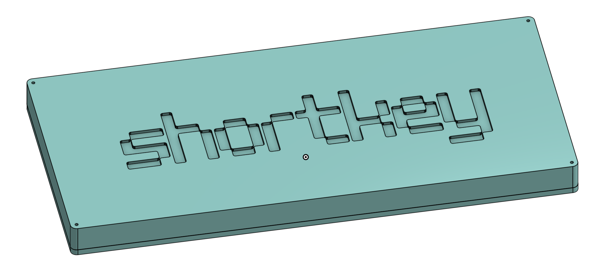

# shortkey

### Why did I make it?
bcz i need more hardware projects in my portfolio and also because it seemed like a fun hardware project which was kinda beginner friendly.

### What was the hardest part about this ?
honestly speaking, ROUTING THE LEDs OMFG.

Features:

- 47 keys with a 12x4 matrix
- nice!nano v2 as the main brain
- BLUETOOTH WIRELESS CONNECTIVITY
- 3.7v lithium battery for wireless
- M3 screws to hold the base and top part of the case together
- 0.91 inch oled display to see stats or anything like a virtual pet
- rgb backlit support with sk6812mini-e
- Custom case

### Schematic

### PCB 

### Case

### 3D view of all parts 

link to full 3d thing-
https://cad.onshape.com/documents/17a945b2f0455e7d6c526103/w/62132080eedaa9216da4dfe5/e/a80dcfc8a4a135788c505977?renderMode=0&uiState=6acfeb995e0cfdd1d2c4e421

## BOM

[BOM](BOM.csv)
|Name                    |Purpose                     |Quantity|Total Cost (USD)|Link                                                                                       |Distributor    |
|------------------------|----------------------------|--------|----------------|-------------------------------------------------------------------------------------------|---------------|
|nice!nano v2            |Main MCU                    |1       |10.17           |https://robu.in/product/pro-micro-nrf52840-development-board-compatible-with-nicenano-v2-0/|Robu           |
|Switches                |Switches for the keyboard   |47      |0               |SELF SOURCED                                                                               |SELF SOURCED   |
|Keycaps for the switches|Keycaps of the switches     |47      |0               |SELF SOURCED                                                                               |SELF SOURCED   |
|0.91 inch display       |Display                     |1       |2.2             |https://robu.in/product/0-91-inch-128x32-i2c-iic-serial-blue-oled-lcd-display-module/      |Robu           |
|SK6812 Mini-E           |LEDs for the switches       |47      |3.26            |https://www.lcsc.com/product-detail/C5149201.html?s_z=n_SK6812MINI-E                       |LCSC           |
|Case 3D Printed         |Case for the entire macropad|1       |0               |Printing Legion                                                                            |Printing Legion|
|PCB                     |Main PCBs                   |5       |9.78            |https://jlcpcb.com/                                                                        |JLPCB          |
|                        |                            |        |                |                                                                                           |               |
|                        |                            |        |25.41           |                                                                                           |               |

## Total Pricing

Final Price comes out to be 2,417.51 INR ($25.41) [ SHIPPING INCLUDED ]

The pricing might slightly vary due to flash sales, and dollar market trends.